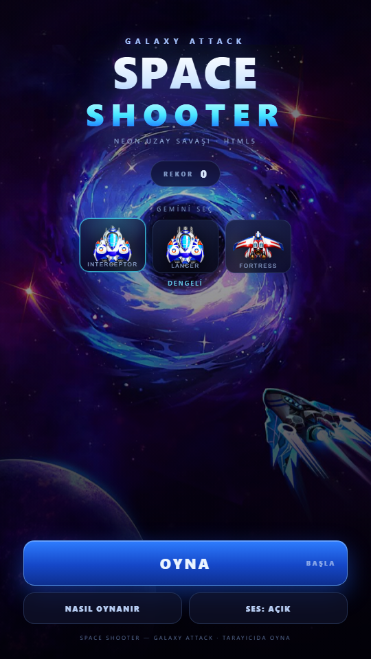

# Space Shooter — Galaxy Attack (HTML5)

Tarayıcıda oynanan dikey uzay savaşı. Oyunun Android sürümündeki grafik, müzik ve ses
efektleri Unity varlıklarından çıkarılıp sıfırdan HTML5 Canvas ile yeniden yazıldı.

## Oyna

**https://saklabann.github.io/**




## Özellikler

- Sonsuz dalga sistemi, her 5. dalgada boss (3 farklı boss ve saldırı deseni)
- 3 seçilebilir gemi (Interceptor / Lancer / Fortress)
- Otomatik ateş, 5 seviye silah, kalkan, bomba, can ve altın toplama
- Kombo çarpanı (×5'e kadar), rekor kaydı (localStorage)
- Mobil dokunmatik (sürükle) ve klavye desteği
- APK'dan alınan orijinal müzik ve ses efektleri
- Tek sayfa, bağımlılıksız statik site (GitHub Pages)

## Kontroller

| Eylem | Girdi |
| --- | --- |
| Hareket | Fare/parmakla sürükle, `WASD` veya ok tuşları |
| Ateş | Otomatik |
| Bomba | `Space` veya sağ alt köşedeki bomba butonu |
| Duraklat | `P` / `Esc` veya sağ üstteki buton |

## Yerel çalıştırma

```bash
python -m http.server 8123
# http://127.0.0.1:8123
```

## Yapı

```
index.html          arayüz iskeleti
css/style.css       menü, HUD ve paneller
js/game.js          oyun döngüsü, dalgalar, boss'lar, ses
assets/img/         gemiler, düşmanlar, boss'lar, kahraman görseli
assets/audio/       müzik (mp3) ve efektler (wav)
```

## Not

Bu sürüm, APK'nın birebir motor portu değildir; APK içindeki Unity (IL2CPP) kodu
tarayıcıda çalıştırılamadığı için oynanış HTML5 Canvas üzerinde yeniden uygulanmış,
görsel ve işitsel varlıklar orijinal oyundan alınmıştır.
